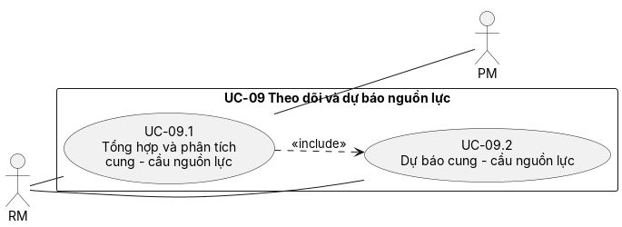
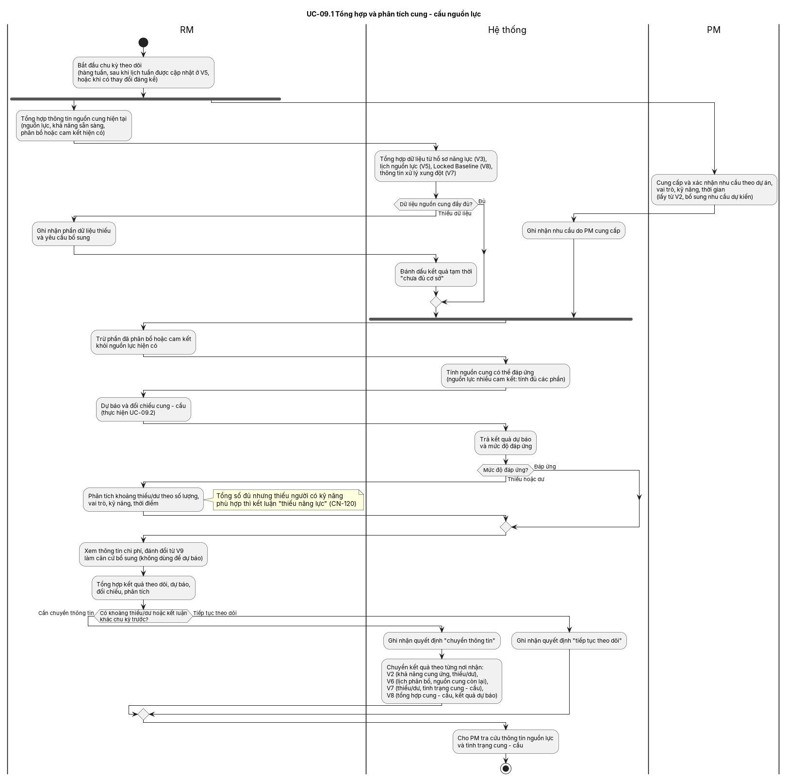
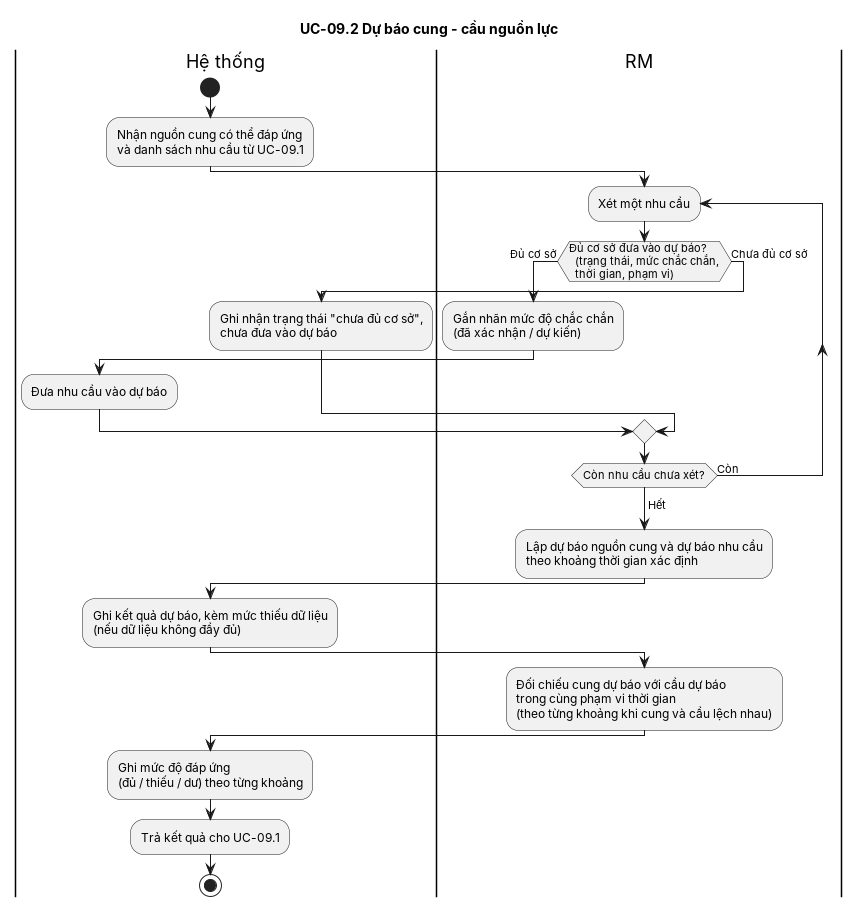
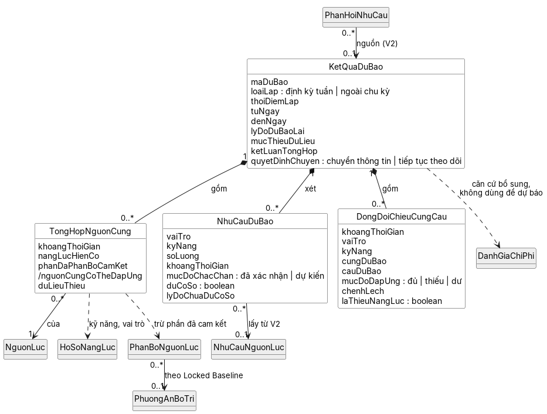

# II.2 — Mô hình hóa chức năng + II.2+ — Đề xuất lớp cho II.3 (V10)

Bài này theo mẫu `[PTTKHT] HOÀN THIỆN MỤC II - PHÂN TÍCH (THIẾT KẾ LOGIC) (1).md`, gồm các mục 1 đến 12.

Mỗi nội dung đều có nguồn: Phần I (`[PTTKHT] I - PHÂN TÍCH YÊU CẦU FINAL.docx`, gọi tắt là **P1**) hoặc HD-PCCN. Chỗ nào nguồn chưa quy định thì ghi **[Chưa xác định]** và đưa vào mục 13 để trưởng nhóm quyết định.

## 1. Thông tin phân công

| Nội dung | Thông tin |
|---|---|
| Thành viên | V10 (do trưởng nhóm đảm nhận) |
| Vùng nghiệp vụ | V10 — Theo dõi và dự báo nguồn lực (UC-09) |
| UC trọng tâm | UC-09.2 theo HD-PCCN §5. Bài này đặc tả cả UC-09.1, vì UC-09.2 không chạy riêng được (xem 2.2) |
| Tên UC | UC-09.1 Tổng hợp và phân tích cung – cầu nguồn lực; UC-09.2 Dự báo cung – cầu nguồn lực |

## 2. Use Case Diagram chi tiết

### 2.1. Xác định UC

| Nội dung | UC-09.1 | UC-09.2 |
|---|---|---|
| Tên UC | Tổng hợp và phân tích cung – cầu nguồn lực | Dự báo cung – cầu nguồn lực |
| Actor chính | RM | RM |
| Actor phụ | PM: cung cấp, xác nhận nhu cầu (CN-114) và tra cứu kết quả (CN-123) | Không có |
| UC liên quan | UC-09.2 (include). Nhận dữ liệu từ UC-01, 02, 04, 06, 07. Chuyển kết quả cho UC-01, 05, 06, 07 | UC-09.1 |

**Căn cứ chọn actor.** P1 I.1.3.10 ghi "Người thực hiện: RM; PM cung cấp, xác nhận nhu cầu và nhận kết quả". P1 I.1.2 cũng ghi RM và PM có tham gia V10.

Bảng UC Summary của HD-PCCN lại ghi actor là "PMO/Portfolio Manager". Bài này theo P1, vì Phần I có thứ tự ưu tiên cao hơn. PMO và CEO chỉ xem kết quả dự báo qua V8 (CN-94), nên không là actor của UC-09. Điểm này cần trưởng nhóm xác nhận: **D-V10-02**.

### 2.2. Quan hệ UC

| UC nguồn | Quan hệ | UC đích | Giải thích |
|---|---|---|---|
| UC-09.1 | `<<include>>` | UC-09.2 | Mỗi chu kỳ, phần phân tích thiếu/dư (CN-120) phải dùng kết quả đối chiếu cung – cầu dự báo (CN-119). Vì vậy UC-09.1 luôn gọi UC-09.2, không có điều kiện. P1 I.1.3.10 bước 4–6 là một chuỗi liền mạch. |

Không có `<<extend>>`. Quan hệ giữa V10 và các vùng khác là bàn giao dữ liệu (P1 I.1.3.1, "Phản hồi liên tục"), không phải UC gọi hành vi của nhau. Vì vậy các quan hệ đó không vẽ trên UCD.

**Phân bổ CN giữa hai UC: điểm cần quyết định D-V10-01.** Hai cách chia đang khác nhau:

| | HD-PCCN (hiện hành) | Đề xuất (theo nội dung CN trong P1) |
|---|---|---|
| UC-09.1 | CN-113 đến CN-121 | CN-113, 114, 115, 120, 121, 122, 123, 124 |
| UC-09.2 | CN-122 đến CN-126 | CN-116, 117, 118, 119, 125, 126 |

Theo cách chia của HD-PCCN:

- Việc lập dự báo (CN-118) và đối chiếu dự báo (CN-119) lại nằm trong UC "Tổng hợp".
- UC "Dự báo" chỉ còn việc chuyển kết quả, tra cứu, xem chi phí và chu kỳ.
- Tên UC vì thế không khớp nội dung.

Cách chia đề xuất giữ nguyên mã CN và mã UC, chỉ đổi CN nào thuộc UC nào. Bài này viết theo cách chia đề xuất. Nếu trưởng nhóm giữ cách của HD-PCCN, chỉ cần chuyển các dòng giữa bảng 3.1.4 và bảng 3.2.4. Luồng nghiệp vụ không đổi.

### 2.3. Use Case Diagram (cấp vùng UC-09)

Nguồn: `UCD_UC-09.puml`. Hình: `UCD_UC-09.png`.

## 3. Use Case Description / FDS chi tiết

### 3.1. UC-09.1 Tổng hợp và phân tích cung – cầu nguồn lực

#### 3.1.1. Thông tin chung

| Trường | Nội dung |
|---|---|
| Mã UC | UC-09.1 |
| Tên UC | Tổng hợp và phân tích cung – cầu nguồn lực |
| Mục tiêu | RM có bức tranh cung – cầu của kỳ: nguồn cung hiện tại, nguồn cung có thể đáp ứng, mức độ đáp ứng và khoảng thiếu/dư theo số lượng, vai trò, kỹ năng, thời điểm. RM quyết định chuyển thông tin cho V2, V6, V7, V8 hay tiếp tục theo dõi |
| Actor chính | RM |
| Actor phụ | PM |
| Trigger | (1) Đến chu kỳ hàng tuần, sau khi lịch của tuần đã được cập nhật ở V5 (P1 I.1.3.10; PCN-03). (2) Có thay đổi đáng kể về nguồn cung, nhu cầu hoặc khoảng thời gian (CN-125). Tiêu chí "đáng kể" là **[Chưa xác định]** (P1 I.3.9 bước 9 có đoạn văn bị lỗi "theo4") |
| Tiền điều kiện | Đã xác định khoảng thời gian cần theo dõi hoặc dự báo (P1 I.1.3.10, đầu vào). Dữ liệu dùng chung tra cứu được: hồ sơ năng lực tập trung (V3) và lịch nguồn lực tập trung (V5) (PCN-02) |
| Hậu điều kiện | **Thành công:** có một KetQuaDuBao cho kỳ, gồm nguồn cung có thể đáp ứng, mức độ đáp ứng, khoảng thiếu/dư và quyết định "chuyển thông tin" hoặc "tiếp tục theo dõi". Nếu chuyển, V2, V6, V7, V8 nhận đúng nhóm thông tin của mình (CN-122). **Dữ liệu chưa đủ:** kết quả được đánh dấu tạm thời, chưa đủ cơ sở để dự báo, và có ghi nhận phần dữ liệu thiếu (CN-113) |

#### 3.1.2. Luồng chính

| Bước | Actor/System | Mô tả |
|---|---|---|
| 1 | Hệ thống | Mở chu kỳ theo dõi cho khoảng thời gian cần theo dõi |
| 2 | RM | Tổng hợp thông tin nguồn cung hiện tại: nguồn lực, khả năng sẵn sàng, phân bổ hoặc cam kết hiện có (CN-113). Làm song song với bước 3 |
| 2.1 | Hệ thống | Cung cấp dữ liệu từ hồ sơ năng lực (V3), lịch nguồn lực và kết luận khả năng tham gia kèm cờ rủi ro quá tải (V5), thông tin xử lý xung đột (V7), phương án Locked Baseline (V8) |
| 3 | PM | Cung cấp và xác nhận nhu cầu theo dự án, vai trò, kỹ năng, thời gian. Nhu cầu lấy từ V2; PM bổ sung nhu cầu dự kiến (CN-114; P1 I.3.9 bước 2) |
| 3.1 | Hệ thống | Ghi nhận nhu cầu do PM cung cấp |
| 4 | RM | Sau khi bước 2 và bước 3 cùng xong, trừ phần đã phân bổ hoặc cam kết khỏi nguồn lực hiện có. Nguồn lực có nhiều cam kết cùng lúc thì tính đủ các phần đã cam kết (CN-115) |
| 4.1 | Hệ thống | Tính và lưu nguồn cung có thể đáp ứng theo nguồn lực và khoảng thời gian |
| 5 | RM | Thực hiện UC-09.2 để có dự báo và mức độ đáp ứng theo từng khoảng thời gian (include) |
| 6 | RM | Với khoảng thời gian bị thiếu hoặc dư, phân tích theo số lượng, vai trò, kỹ năng, thời điểm. Nếu tổng số đủ nhưng thiếu người có kỹ năng phù hợp, kết luận là "thiếu năng lực" (CN-120) |
| 7 | RM | Xem thông tin chi phí, đánh đổi từ V9 làm căn cứ bổ sung. Thông tin này không dùng để dự báo (CN-124; QT-57) |
| 8 | RM | Tổng hợp kết quả theo dõi, dự báo, đối chiếu, phân tích. Có khoảng thiếu/dư, hoặc kết luận khác chu kỳ trước, thì quyết định chuyển thông tin (CN-121; P1 I.3.9 bước 7) |
| 9 | Hệ thống | Ghi nhận quyết định chuyển thông tin. Chuyển kết quả theo từng nơi nhận: V2 nhận khả năng cung ứng và khoảng thiếu/dư; V6 nhận lịch phân bổ hiện tại và nguồn cung còn lại; V7 nhận thông tin thiếu/dư và tình trạng cung – cầu; V8 nhận thông tin tổng hợp cung – cầu và kết quả dự báo (CN-122) |
| 10 | PM | Tra cứu thông tin nguồn lực và tình trạng cung – cầu phục vụ theo dõi, điều hành (CN-123) |
| 11 | | Kết thúc. Kết quả được giữ nguyên đến chu kỳ tuần tiếp theo, nếu không có thay đổi đáng kể (CN-126) |

#### 3.1.3. Luồng thay thế / ngoại lệ

| Mã | Tại bước | Điều kiện | Xử lý |
|---|---|---|---|
| E1 | 2 | Dữ liệu nguồn cung thiếu | RM ghi nhận phần dữ liệu thiếu và yêu cầu bổ sung. Hệ thống đánh dấu kết quả tạm thời "chưa đủ cơ sở để dự báo" và ghi mức thiếu dữ liệu vào kết quả (CN-113; QT-55). Use case tiếp tục bước 4 với dữ liệu hiện có. **[Chưa xác định]** Nếu thiếu dữ liệu thì có dừng chu kỳ hay vẫn dự báo kèm cảnh báo: P1 chỉ nói "chưa đủ cơ sở để dự báo" (I.1.3.10 bước 1) và "thể hiện rõ mức thiếu dữ liệu" (QT-55). Xem D-V10-03 |
| A1 | 6 | Mức độ đáp ứng là "đủ" ở mọi khoảng thời gian | Bỏ qua bước 6, sang bước 7 |
| A2 | 8 | Không có khoảng thiếu/dư và kết luận giống chu kỳ trước | Hệ thống ghi nhận quyết định "tiếp tục theo dõi" và không chuyển thông tin. Use case sang bước 10 |
| A3 | Trigger | Có thay đổi đáng kể giữa hai chu kỳ | RM cập nhật dữ liệu và chạy lại use case ngoài chu kỳ, trong vòng 1 ngày làm việc kể từ khi ghi nhận thay đổi (CN-125; PCN-03). KetQuaDuBao mới có loaiLap là "ngoài chu kỳ" |

#### 3.1.4. Business Rules / yêu cầu liên quan

| ID | Nội dung (rút gọn từ P1) | Vai trò trong UC |
|---|---|---|
| CN-113 | RM tổng hợp nguồn cung hiện tại, ghi nhận dữ liệu thiếu và yêu cầu bổ sung | Bước 2, E1 |
| CN-114 | PM cung cấp và xác nhận nhu cầu theo dự án, vai trò, kỹ năng, thời gian | Bước 3 |
| CN-115 | RM xác định nguồn cung có thể đáp ứng | Bước 4 |
| CN-120 | RM phân tích thiếu/dư theo 4 chiều; tổng đủ nhưng thiếu kỹ năng thì là thiếu năng lực | Bước 6 |
| CN-121 | RM tổng hợp và ghi nhận quyết định chuyển thông tin hoặc tiếp tục theo dõi | Bước 8, A2 |
| CN-122 | RM chuyển kết quả cho V2, V6, V7, V8 | Bước 9 |
| CN-123 | PM tra cứu thông tin nguồn lực và tình trạng cung – cầu | Bước 10 |
| CN-124 | RM xem chi phí, đánh đổi từ V9 làm căn cứ bổ sung, không dùng để dự báo | Bước 7 |
| QT-54 / RB-55 | Khả năng cung ứng phải xét cùng phần đã phân bổ hoặc cam kết; thiếu được phân tích theo số lượng, vai trò, kỹ năng, thời điểm | Bước 4, 6 |
| QT-55 / RB-56 | Dữ liệu không đầy đủ thì kết quả phải thể hiện rõ mức thiếu dữ liệu | E1 |
| QT-56 / RB-57 | Cung hoặc cầu thay đổi đáng kể thì cập nhật dự báo | A3 |
| QT-57 / RB-58 | Chu kỳ hàng tuần; không dùng dữ liệu lịch sử, cơ hội kinh doanh; chi phí V9 không dùng để dự báo | Trigger, bước 7 |
| RB-62 | V10 chỉ cung cấp thông tin; xử lý thiếu/dư thuộc V7, V8 hoặc cấp có thẩm quyền | Bước 8–9: không có bước "đề xuất xử lý" |
| PCN-02 | Hồ sơ năng lực và lịch phân bổ mỗi loại chỉ có một nơi lưu | Bước 2.1: V10 tra cứu, không tạo bản sao |
| PCN-03 | Mỗi tuần một lần, sau khi lịch tuần cập nhật ở V5; thay đổi đáng kể thì dự báo lại trong 1 ngày làm việc | Trigger, A3 |

### 3.2. UC-09.2 Dự báo cung – cầu nguồn lực

#### 3.2.1. Thông tin chung

| Trường | Nội dung |
|---|---|
| Mã UC | UC-09.2 |
| Tên UC | Dự báo cung – cầu nguồn lực |
| Mục tiêu | RM có dự báo nguồn cung và nhu cầu theo khoảng thời gian xác định, đối chiếu được trong cùng phạm vi thời gian, và có mức độ đáp ứng (đủ, thiếu hoặc dư) cho từng khoảng |
| Actor chính | RM |
| Actor phụ | Không có |
| Trigger | UC-09.1 gọi tại bước 5 |
| Tiền điều kiện | Đã có nguồn cung có thể đáp ứng và danh sách nhu cầu của kỳ (UC-09.1 bước 4) |
| Hậu điều kiện | Mỗi nhu cầu được ghi "đủ cơ sở" (có nhãn mức độ chắc chắn) hoặc "chưa đủ cơ sở" (chưa đưa vào dự báo). Có dự báo cung và cầu gắn khoảng thời gian, cùng mức độ đáp ứng cho từng khoảng. Dữ liệu không đầy đủ thì kết quả ghi rõ mức thiếu dữ liệu |

#### 3.2.2. Luồng chính

| Bước | Actor/System | Mô tả |
|---|---|---|
| 1 | Hệ thống | Nhận nguồn cung có thể đáp ứng và danh sách nhu cầu từ UC-09.1 |
| 2 | RM | Với từng nhu cầu, xét có đủ cơ sở đưa vào dự báo không, dựa trên trạng thái, mức độ chắc chắn, thời gian và phạm vi (CN-116) |
| 3 | RM | Gắn nhãn mức độ chắc chắn ("đã xác nhận" hoặc "dự kiến") cho nhu cầu đủ cơ sở (CN-117; QT-55) |
| 4 | Hệ thống | Đưa nhu cầu đủ cơ sở vào dự báo. Lặp lại bước 2–4 đến khi xét hết nhu cầu |
| 5 | RM | Lập dự báo nguồn cung và dự báo nhu cầu theo khoảng thời gian xác định (CN-118; QT-52) |
| 6 | Hệ thống | Ghi kết quả dự báo, kèm mức thiếu dữ liệu nếu dữ liệu không đầy đủ (QT-55) |
| 7 | RM | Đối chiếu cung dự báo với cầu dự báo trong cùng phạm vi thời gian. Thời điểm cung và cầu lệch nhau thì đối chiếu theo từng khoảng thời gian (CN-119) |
| 8 | Hệ thống | Ghi mức độ đáp ứng (đủ, thiếu hoặc dư) cho từng khoảng và trả kết quả cho UC-09.1 |
| 9 | | Kết thúc |

#### 3.2.3. Luồng thay thế / ngoại lệ

| Mã | Tại bước | Điều kiện | Xử lý |
|---|---|---|---|
| A1 | 2 | Nhu cầu chưa đủ cơ sở | Hệ thống ghi nhận trạng thái "chưa đủ cơ sở" kèm lý do. Nhu cầu chưa được đưa vào dự báo (CN-116). Quay lại bước 2 với nhu cầu tiếp theo |
| A2 | 7 | Cung và cầu không cùng mốc thời gian | Chia thành từng khoảng thời gian và đối chiếu riêng từng khoảng (CN-119; QT-52) |

Không thêm nhánh "phương pháp dự báo không phù hợp" hay "ngưỡng cảnh báo". P1 không quy định phương pháp dự báo; chỉ cấm dùng dữ liệu lịch sử và dữ liệu cơ hội kinh doanh (QT-57). Xem D-V10-04.

#### 3.2.4. Business Rules / yêu cầu liên quan

| ID | Nội dung (rút gọn từ P1) | Vai trò trong UC |
|---|---|---|
| CN-116 | RM xác định nhu cầu đủ cơ sở; ghi trạng thái nhu cầu chưa đủ cơ sở | Bước 2, A1 |
| CN-117 | RM gắn nhãn mức độ chắc chắn | Bước 3 |
| CN-118 | RM lập dự báo cung và cầu theo khoảng thời gian | Bước 5 |
| CN-119 | RM đối chiếu trong cùng phạm vi thời gian, xác định mức độ đáp ứng | Bước 7–8, A2 |
| CN-125 | Dự báo lại ngoài chu kỳ khi có thay đổi đáng kể | Lần gọi từ UC-09.1 A3 |
| CN-126 | Dự báo theo chu kỳ tuần; giữ nguyên dự báo khi không có thay đổi đáng kể | Lần gọi định kỳ |
| QT-52 / RB-53 | Dự báo gắn khoảng thời gian; cung, cầu đối chiếu trong cùng phạm vi | Bước 5, 7 |
| QT-53 / RB-54 | Nhu cầu có thể xác định trước khi có nhân sự cụ thể | Bước 2: nhu cầu không bắt buộc gắn nguồn lực |
| QT-55 / RB-56 | Phân biệt mức độ chắc chắn; thể hiện mức thiếu dữ liệu | Bước 3, 6 |
| QT-57 / RB-58 | Không dùng dữ liệu lịch sử, cơ hội kinh doanh, chi phí V9 để dự báo | Bước 5 |

## 4. Activity Diagram

### 4.1. UC-09.1: xác định thành phần

| Thành phần | Nội dung |
|---|---|
| Điểm bắt đầu | Mở chu kỳ theo dõi (hàng tuần hoặc khi có thay đổi đáng kể) |
| Swimlane | RM, Hệ thống, PM |
| Activity/Action | Theo luồng chính 3.1.2, bước 1–10 |
| Decision | "Dữ liệu nguồn cung đầy đủ?" (E1); "Mức độ đáp ứng?" (A1); "Có khoảng thiếu/dư hoặc kết luận khác chu kỳ trước?" (A2) |
| Merge | Sau mỗi Decision |
| Fork/Join | Fork sau điểm bắt đầu: RM tổng hợp nguồn cung, song song với PM cung cấp nhu cầu. Join trước bước 4 (P1 I.1.3.10 bước 2–3, "sau khi hai nhánh hội tụ") |
| Gọi UC khác | Bước 5 "Dự báo và đối chiếu (thực hiện UC-09.2)" là một action. AD không dùng ký hiệu include |
| Điểm kết thúc | Sau khi PM có thể tra cứu kết quả |

Nguồn: `AD_UC-09.1.puml`. Hình: `AD_UC-09_1.png`.

### 4.2. UC-09.2: xác định thành phần

| Thành phần | Nội dung |
|---|---|
| Điểm bắt đầu | Nhận dữ liệu từ UC-09.1 |
| Swimlane | Hệ thống, RM |
| Decision | "Đủ cơ sở đưa vào dự báo?" (A1); vòng lặp "Còn nhu cầu chưa xét?" |
| Merge | Sau Decision "Đủ cơ sở" |
| Fork/Join | Không có |
| Điểm kết thúc | Sau khi trả kết quả cho UC-09.1 |

Nguồn: `AD_UC-09.2.puml`. Hình: `AD_UC-09_2.png`.

## 5. Đối chiếu UC — UCD — AD

| Kiểm tra | UC-09.1 | UC-09.2 |
|---|---|---|
| Actor trong Description có trên UCD | ✓ RM, PM | ✓ RM |
| Quan hệ trong Description có trên UCD | ✓ include 09.2 | ✓ |
| Mỗi action trên AD có bước tương ứng trong Description | ✓ | ✓ |
| Thứ tự bước trong Description khớp AD | ✓ | ✓ |
| Luồng thay thế/ngoại lệ có trên AD | ✓ E1, A1, A2. A3 là trigger, thể hiện ở nút bắt đầu | ✓ A1. A2 nằm trong action "đối chiếu theo từng khoảng" |
| Bắt đầu/kết thúc nhất quán | ✓ | ✓ |
| Không chứa bước của UC khác | ✓ Không có bước xử lý thiếu/dư (RB-62) | ✓ |

# II.2+ — Đề xuất lớp cho II.3

## 6. Phân tích văn bản để xác định lớp

### 6.1. Danh từ / đối tượng nghiệp vụ

| Danh từ | Có phải lớp? | Giải thích |
|---|---|---|
| Kết quả dự báo (một lần dự báo của kỳ) | **Có** | Có vòng đời riêng: mỗi tuần lập một lần, giữ nguyên đến chu kỳ sau, lập lại khi có thay đổi (CN-125, 126). Được chuyển cho 4 vùng (CN-122). Có thuộc tính riêng: khoảng thời gian, mức thiếu dữ liệu, quyết định chuyển. Không lưu được trong đối tượng của vùng khác, vì không có đối tượng nào khác sở hữu kỳ dự báo |
| Nguồn cung có thể đáp ứng | **Có** (TongHopNguonCung) | Kết quả bước 4, tính theo từng nguồn lực và khoảng thời gian. V6 cần "nguồn cung còn lại" (CN-122) |
| Nhu cầu đưa vào dự báo | **Có** (NhuCauDuBao) | Có thuộc tính mà NhuCauNguonLuc của V2 không có: mức độ chắc chắn, đủ/chưa đủ cơ sở (CN-116, 117). Có cả nhu cầu dự kiến chưa lập ở V2 (P1 I.3.9 bước 2; QT-53) |
| Mức độ đáp ứng, khoảng thiếu/dư | **Có** (DongDoiChieuCungCau) | Mỗi khoảng thời gian × vai trò/kỹ năng có một kết quả đối chiếu (CN-119, 120) |
| Nguồn lực, hồ sơ năng lực, lịch phân bổ, phương án Locked Baseline, nhu cầu nguồn lực | Không (tham chiếu) | Thuộc V3, V5, V8, V2 (PCN-02). V10 chỉ tham chiếu, không sao chép |
| Thông tin chi phí V9 | Không (tham chiếu) | Lớp DanhGiaChiPhi của V9. Chỉ là phụ thuộc, không dùng để dự báo |
| RM, PM | Không | Là actor |
| Tiêu chí "thay đổi đáng kể", ngưỡng cảnh báo | Không | P1 chưa quy định (D-V10-05). Không tạo lớp cấu hình |

### 6.2. Động từ / hành vi nghiệp vụ

| # | Hành vi | Lớp chịu trách nhiệm | Ghi chú |
|---|---|---|---|
| 1 | Tổng hợp nguồn cung, tính nguồn cung có thể đáp ứng | TongHopNguonCung | CN-113, 115 |
| 2 | Xét đủ cơ sở, gắn nhãn chắc chắn | NhuCauDuBao | CN-116, 117 |
| 3 | Lập dự báo, ghi mức thiếu dữ liệu | KetQuaDuBao | CN-118; QT-55 |
| 4 | Đối chiếu, phân tích thiếu/dư | DongDoiChieuCungCau | CN-119, 120 |
| 5 | Ghi quyết định chuyển / tiếp tục theo dõi | KetQuaDuBao | CN-121 |
| 6 | Chuyển kết quả cho V2, V6, V7, V8 | Không gán lớp | Là bàn giao giữa vùng. Bên nhận lưu theo lớp của mình (V2: PhanHoiNhuCau) |

## 7. Xác định lớp miền

| Lớp | Ý nghĩa nghiệp vụ | Nguồn |
|---|---|---|
| KetQuaDuBao | Một lần theo dõi – dự báo cho một khoảng thời gian, định kỳ tuần hoặc ngoài chu kỳ | CN-118, 121, 122, 125, 126; QT-52, 55, 57 |
| TongHopNguonCung | Nguồn cung hiện tại và nguồn cung có thể đáp ứng của một nguồn lực trong một khoảng | CN-113, 115; QT-54 |
| NhuCauDuBao | Một nhu cầu được xét để đưa vào dự báo | CN-114, 116, 117; QT-53, 55 |
| DongDoiChieuCungCau | Kết quả đối chiếu cung – cầu của một khoảng thời gian theo vai trò/kỹ năng | CN-119, 120 |

## 8. Xác định thuộc tính

| Lớp | Thuộc tính | Ý nghĩa / căn cứ |
|---|---|---|
| KetQuaDuBao | maDuBao, thoiDiemLap, tuNgay, denNgay | Dự báo gắn khoảng thời gian xác định (QT-52) |
| | loaiLap | "định kỳ tuần" hoặc "ngoài chu kỳ" (CN-125, 126) |
| | lyDoDuBaoLai | Thay đổi đáng kể đã ghi nhận (CN-125) |
| | mucThieuDuLieu | QT-55. Cách biểu diễn (mô tả hay mức) **[Chưa xác định]** |
| | ketLuanTongHop | Kết quả tổng hợp (CN-121) |
| | quyetDinhChuyen | "chuyển thông tin" hoặc "tiếp tục theo dõi" (CN-121) |
| TongHopNguonCung | khoangThoiGian, nangLucHienCo, phanDaPhanBoCamKet, /nguonCungCoTheDapUng, duLieuThieu | Thuộc tính `/` là thuộc tính suy ra = năng lực hiện có trừ phần đã cam kết (CN-115) |
| NhuCauDuBao | vaiTro, kyNang, soLuong, khoangThoiGian | CN-114 |
| | mucDoChacChan | "đã xác nhận" hoặc "dự kiến" (CN-117) |
| | duCoSo, lyDoChuaDuCoSo | CN-116 |
| DongDoiChieuCungCau | khoangThoiGian, vaiTro, kyNang, cungDuBao, cauDuBao | CN-119, 120 |
| | mucDoDapUng | "đủ", "thiếu" hoặc "dư" (P1 I.1.3.10 bước 5) |
| | chenhLech | Số lượng thiếu/dư (CN-120) |
| | laThieuNangLuc | Tổng đủ nhưng thiếu kỹ năng (CN-120) |

Không thêm thuộc tính "ngưỡng", "phương pháp dự báo", "độ tin cậy %", vì P1 không quy định.

## 9. Xác định thao tác

Sơ đồ II.3 là mô hình miền nên ẩn thao tác. Nếu II.4 cần, gợi ý như sau:

| Lớp | Operation | Ý nghĩa |
|---|---|---|
| TongHopNguonCung | tinhNguonCungCoTheDapUng() | CN-115 |
| NhuCauDuBao | xetCoSo(), ganMucChacChan() | CN-116, 117 |
| KetQuaDuBao | lapDuBao(), ghiQuyetDinhChuyen() | CN-118, 121 |
| DongDoiChieuCungCau | doiChieu(), phanTichThieuDu() | CN-119, 120 |

## 10. Xác định quan hệ giữa các lớp

| Lớp A | Quan hệ | Lớp B | Giải thích |
|---|---|---|---|
| KetQuaDuBao | Composition | TongHopNguonCung, NhuCauDuBao, DongDoiChieuCungCau | Các phần này chỉ có nghĩa trong một kỳ dự báo |
| TongHopNguonCung | Association | NguonLuc (V3/chung) | Nguồn cung của một nguồn lực |
| TongHopNguonCung | Dependency | PhanBoNguonLuc (V5), HoSoNangLuc (V3) | Tra cứu khi tính, không lưu bản sao (PCN-02) |
| NhuCauDuBao | Association | NhuCauNguonLuc (V2) | Nhu cầu đã có ở V2. Bằng 0 với nhu cầu dự kiến chưa lập (QT-53) |
| KetQuaDuBao | Dependency | DanhGiaChiPhi (V9) | Chỉ xem làm căn cứ bổ sung (CN-124) |
| PhanHoiNhuCau (V2) | Association | KetQuaDuBao | V2 ghi nhận phản hồi có nguồn từ V10 (CN-17) |

## 11. Xác định multiplicity

| Quan hệ | Multiplicity | Căn cứ |
|---|---|---|
| KetQuaDuBao – TongHopNguonCung | 1 – 0..* | Kỳ có thể chưa có dữ liệu cung (E1) |
| KetQuaDuBao – NhuCauDuBao | 1 – 0..* | Kỳ có thể chưa có nhu cầu |
| KetQuaDuBao – DongDoiChieuCungCau | 1 – 0..* | Chỉ có khi có cung/cầu để đối chiếu |
| TongHopNguonCung – NguonLuc | 0..* – 1 | Mỗi dòng của một nguồn lực, mỗi kỳ một dòng/khoảng |
| NhuCauDuBao – NhuCauNguonLuc | 0..* – 0..1 | Nhu cầu dự kiến chưa có ở V2 (QT-53; P1 I.3.9 bước 2). **D-V10-06** |
| PhanHoiNhuCau – KetQuaDuBao | 0..* – 0..1 | Phản hồi V2 có thể từ V4 (không có KetQuaDuBao) |

## 12. Domain/Class Diagram đề xuất

Lớp nền xám thuộc vùng khác; V10 chỉ tham chiếu. Nguồn: `Class_V10.puml`. Hình: `Class_V10.png`.

## 13. Giao tiếp với các vùng khác

| Chiều | Vùng | Dữ liệu | Chủ thể chịu trách nhiệm dữ liệu | Căn cứ |
|---|---|---|---|---|
| Nhận | V2 | Nhu cầu nguồn lực (PM cung cấp, xác nhận) | PM / V2 (NhuCauNguonLuc) | P1 I.1.3.10 đầu vào; CN-114 |
| Nhận | V3 | Hồ sơ năng lực tập trung | RM / V3 (HoSoNangLuc) | CN-30; PCN-02 |
| Nhận | V5 | Lịch nguồn lực, khả năng tham gia, cờ rủi ro quá tải | RM / V5 | CN-50; PCN-02, 03 |
| Nhận | V7 | Thông tin xử lý xung đột, phương án đã cân đối | RM / V7 | CN-88 |
| Nhận | V8 | Phương án Locked Baseline (cam kết hiện có) | PMO/CEO / V8 | CN-100 |
| Nhận | V9 | Chi phí, đánh đổi (chỉ căn cứ bổ sung) | PM, Tài chính / V9 | CN-112, 124 |
| Cung cấp | V2 | Khả năng cung ứng, khoảng thiếu/dư | RM / V10 | CN-122, CN-17 |
| Cung cấp | V6 | Lịch phân bổ hiện tại, nguồn cung còn lại | RM / V10 | CN-122, CN-61 |
| Cung cấp | V7 | Thông tin thiếu/dư, tình trạng cung – cầu | RM / V10 | CN-122, CN-75 |
| Cung cấp | V8 | Thông tin tổng hợp cung – cầu, kết quả dự báo | RM / V10 | CN-122, CN-94 |
| Cung cấp | PM | Thông tin nguồn lực, tình trạng cung – cầu | RM / V10 | CN-123 |

Ghi chú: "lịch phân bổ hiện tại" gửi V6 là dữ liệu của V5 (PCN-02). V10 chuyển phần đã tổng hợp, không trở thành nơi lưu thứ hai.

## 14. Điểm chưa xác định cần trưởng nhóm quyết định

| Mã | Câu hỏi | Đề xuất | Nếu chưa quyết |
|---|---|---|---|
| D-V10-01 | Phân bổ CN giữa UC-09.1 và UC-09.2 theo HD-PCCN hay theo nội dung? | Theo nội dung (mục 2.2) | Bảng BR hai UC không khớp tên UC |
| D-V10-02 | Actor của UC-09: RM (P1) hay PMO (HD-PCCN)? | RM chính, PM phụ (P1) | II.1 và UCD vùng mâu thuẫn |
| D-V10-03 | Thiếu dữ liệu nguồn cung thì dừng hay vẫn dự báo kèm cảnh báo? | Vẫn dự báo, ghi mức thiếu dữ liệu (QT-55) | E1 có hai cách hiểu |
| D-V10-04 | P1 không quy định phương pháp dự báo. Có cần mô tả không? | Không. Ghi "theo quy định của doanh nghiệp, không dùng dữ liệu lịch sử" | Thành viên tự đặt công thức |
| D-V10-05 | Tiêu chí "thay đổi đáng kể" (P1 I.3.9 bước 9 có đoạn văn bị lỗi "theo4") | Sửa câu trong Phần I: ghi đúng nguồn tiêu chí, hoặc ghi "do RM xác định" | Trigger A3 không kiểm tra được |
| D-V10-06 | Nhu cầu dự kiến (chưa lập ở V2) có lưu riêng không? | Có, qua NhuCauDuBao với liên kết 0..1 | Mất nhu cầu dự kiến (QT-53) |
| D-V10-07 | HD-PCCN UC Summary của UC-09.2 ghi "dữ liệu lịch sử" và "khuyến nghị", trái QT-57 và RB-62 | Sửa HD-PCCN theo P1 | Mâu thuẫn tài liệu |
